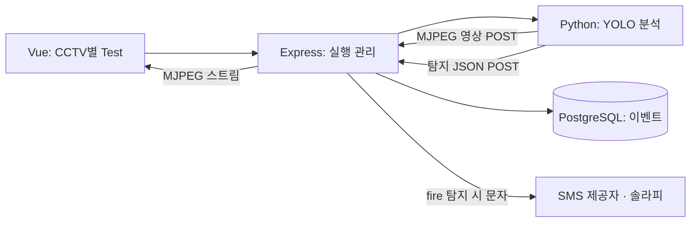

# FireGuard AI 시스템 아키텍처

[API 명세](API_SPEC.md) · [ERD](DATABASE.md) · [ADR](ADR.md)

## 카메라별 Test 목표 흐름

- `source_type=test` 카메라마다 등록된 영상 하나를 분석
- Backend가 Python에 원본 파일 경로와 실행 ID를 전달
- AI가 바운딩박스 프레임과 탐지 JSON을 각각 Backend API로 전송
- Test 영상은 원본 영상 시각 기준 초당 5프레임을 선택해 YOLO 분석, 고정 6프레임 간격 분석 대체
- 불 confidence 0.3 이상·연기 0.5 이상을 클래스별로 판정, 같은 클래스이며 직전 박스와 IoU 0.2 이상인 영역을 일대일 연결
- 최근 20개 분석 프레임(약 4초)이 채워지고 같은 영역에서 16회 이상 탐지된 경우에만 탐지 JSON·위치 추정 전송, 이후 조건을 유지하는 현재 탐지로 이벤트 갱신
- 한 영역은 프레임당 한 표로 집계, 탐지 없는 프레임도 분모에 포함, 박스 영상은 확정 전 후보도 표시
- 분석 시각 간격이 0.4초 초과·역행하면 판정 초기화, 중복 프레임으로 20개를 채우지 않으며 5fps 미만·FPS 불명인 원본 영상은 실행 오류
- 32×18 회색 영상의 평균 절대 차이가 255의 25% 초과이거나 해상도가 바뀌면 판정 초기화, 기존 고정 자세의 재사용을 막기 위해 해당 실행의 위치 추정은 이후 null
- 장면 차이 비교는 큰 전환 감지용이며 점진적인 PTZ 이동의 완전한 감지는 미구현, 위 판정은 현재 Test 실행 경로에 적용
- Backend가 MJPEG 프레임을 중계하고 탐지 이벤트 저장
- 알림 중이 아닌 카메라에 `fire` 이벤트가 새로 생기면 해당 카메라에 설정된 번호로 문자 발송, `smoke`는 화면 표시만
- 발송 결과는 `sms_logs`에 기록, 발송 실패가 탐지 저장을 막지 않음
- 카메라별 번호 설정과 발송 내역은 문자 알림 관리 화면에서 관리
- 결과 영상 파일은 저장하지 않음

## 구성 요소

| 구성 요소 | 역할 |
| --- | --- |
| Frontend · Vue/Vite | CCTV·탐지 정보 표시, 지도·카메라 선택, ITS HLS 6개 상시 재생·선택 확대, 관리자 Test 실행·상태·MJPEG 표시 |
| Backend · Node.js/Express | API, Python 실행, 영상 중계, 이벤트 저장, ITS 목록 수동 갱신·캐시, 화재 탐지 SMS 발송·기록 |
| AI · Python/YOLO26n | 영상 프레임 분석, 바운딩박스·탐지 JSON 생성 |
| DB · PostgreSQL | 카메라·영상·이벤트·관리자·카메라별 알림 번호·SMS 발송 기록 저장 |
| 지도 · 네이버 Maps | CCTV와 추정 화점 위치 표시 |

## 영상 입력

- `test` 카메라: `data/videos/`의 등록 MP4
- `live` 카메라: 수동 갱신한 ITS CCTV HLS 주소, 브라우저에서 직접 재생
- 관제 화면은 저장된 최대 6개 CCTV를 동시에 재생, 선택하면 지도 오른쪽 상세 패널에 같은 영상을 공유해 표시(추가 연결 없음), 첫 연결 전 상태 문구 표시
- ITS 키는 Backend 환경변수에만 저장, 목록 API는 관리자 로그인 후 `CCTV 주소 갱신` 버튼으로만 호출
- 서버 시작·화면 조회·재생 실패 시 ITS를 호출하지 않음, 갱신 전에는 `data/its-cctv-cache.json`의 저장된 목록만 표시(최초는 비어 있음)
- 영상 연결 오류는 10초 이상 간격으로 최대 3회 자동 재연결, 계속 실패하면 원인(HTTP 상태 등)을 화면에 표시
- 재생 중과 일시적인 버퍼 대기 중에는 영상 위에 연결·재연결 문구를 표시하지 않고, 재생 전 연결 안내와 재생이 멈춘 뒤의 실패 원인만 영상 위에 표시
- HLS 유형 `cctvType=1`의 운영 응답은 HTTP 주소, HTTPS 화면 배포 시 영상 전달 경로 추가 필요
- Backend는 시작 시 저장된 CCTV 6곳을 감시 작업자에 전달, AI 파일이 없으면 대기 상태 표시
- 감시 작업자 종료·프레임 상태 신호 120초 누락 시 Backend가 작업자를 재시작
- Frontend는 30초마다 감시 상태와 탐지 이벤트 조회, 실패 시 마지막 결과와 오류 표시
- 기본 실시간 작업자는 `ai/inference/live_runner.py`, 카메라별 HLS 수신 스레드와 최대 3프레임 대기열을 사용하고 공유 모델로 묶어 추론
- 5fps·16/20 판정을 카메라별 유지, 누락·재접속·큰 장면 변화 시 초기화, 수신 후 1초 넘은 프레임은 폐기하고 30초마다 실제 분석 FPS·누적 폐기 수를 Backend 로그에 기록
- 실시간 위치 추정은 이름이 일치하는 고정 자세 보정 카메라만 지원, 무보정 카메라와 큰 장면 전환 이후에는 null로 탐지만 전송
- 실시간 탐지 이벤트는 영상 ID 없이 카메라 ID로 저장, 원본 파일과 결과 프레임은 DB에 저장하지 않음
- 컬럼과 관계는 [ERD](DATABASE.md), 요청·응답은 [API 명세](API_SPEC.md) 참고

## 현재 구현 상태

### 구현

- Backend: 카메라·영상·이벤트 조회, 로컬 영상 스트리밍, 관리자 로그인·JWT, 카메라별 Test 실행·AI 프로세스 실행·MJPEG 중계, 탐지 JSON 검증·저장
- Backend: ITS 6개 CCTV 목록 수동 갱신·캐시, 감시 작업자 시작·상태·재시작, 프레임 상태 신호 수신
- Backend: 이벤트 확인 API(`acknowledged_at` 기록)
- Backend: 카메라별 알림 번호 관리 API, `fire` 탐지 시 SMS 발송과 발송 기록 조회
- Frontend: 지도(확대·닫기, 카메라 좌표, 추정 화점), 지도 아래 ITS HLS 6개 상시 재생, 선택 시 우측 패널 영상 표시, 이벤트 목록, 요약 지표
- Frontend: 알림 중인 `fire` 이벤트(확인 전이고 마지막 탐지가 30분 안)가 있는 카메라는 지도 마커를 빨간색으로 표시, 30분이 지나면 자동으로 파란색, 새 `fire` 이벤트가 조회되면 상단 배너와 알림음(브라우저가 허용한 경우), 관리자 로그인 후 확인해도 파란색으로 복귀, 이벤트 전체 목록은 카메라 이름 표시
- Frontend: 관리자 로그인 후 Test 실행·상태·MJPEG 표시, 카메라별 알림 번호 설정, 문자 발송 내역
- SMS 제공자는 `console`(기본)과 `solapi`, 가입 본인인증 번호를 발신번호로 쓰는 데모 범위
- 문자는 카메라가 알림 중(확인 전이고 마지막 `fire` 탐지가 30분 안)이 아닐 때 새 `fire` 이벤트가 생길 때만 발송, 작업자·서버 재시작 후에도 중복 발송하지 않음
- 탐지 JSON의 `location_estimation`은 저장하고 지도에 추정 위치로 표시
- AI: Test 실행 시 Backend가 카메라 이름·위경도를 넘기고, 실행 시작 시 카메라 자세를 1회 정한 뒤 탐지마다 추정 위치를 `location_estimation`에 포함

### 미구현 (AI 담당)

- 실시간 6대 동시 분석의 실제 장비 처리 속도·오탐률 검증
- 위치 추정 오차 범위(`error_range_m`), 실행 중 PTZ 자세 변화 감지

### 검증 상태

- 실키 검증: ITS CCTV 6개 HLS 재생목록·영상 조각·CORS 응답, 브라우저 재생 확인
- 솔라피 실발송 1건 확인(SMS 18P, 단말 도착), 운영용 제공자와 별도 발신번호 등록은 미정
- 6개 동시 재생의 부하·끊김은 실제 관제 PC에서 확인 필요
- 영상 서버에 짧은 시간 반복 접속하면 거절될 수 있음(2026-11-03 관찰), 발표 전 새로고침 반복 주의
- 네이버 지도는 콘솔에 등록한 URL로 접속해야 인증 성공

### 개발 환경

- 브라우저 → Vite → Express → PostgreSQL
