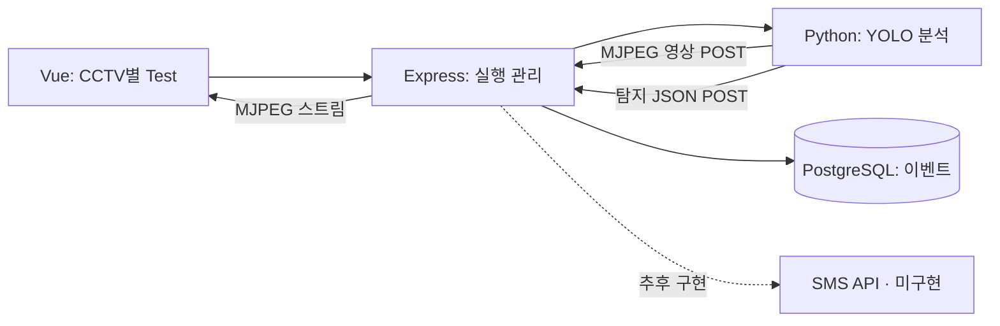

# FireGuard AI 시스템 아키텍처

[API 명세](API_SPEC.md) · [ERD](DATABASE.md) · [ADR](ADR.md)

## 카메라별 Test 목표 흐름

- `source_type=test` 카메라마다 등록된 영상 하나를 분석
- Backend가 Python에 원본 파일 경로와 실행 ID를 전달
- AI가 바운딩박스 프레임과 탐지 JSON을 각각 Backend API로 전송
- Backend가 MJPEG 프레임을 중계하고 탐지 이벤트 저장
- SMS 발송은 아직 구현되지 않음
- 결과 영상 파일은 저장하지 않음

## 구성 요소

| 구성 요소 | 역할 |
| --- | --- |
| Frontend · Vue/Vite | CCTV·탐지 정보 표시, 지도·카메라 선택, ITS HLS 재생, 관리자 Test 실행·상태·MJPEG 표시 |
| Backend · Node.js/Express | API, Python 실행, 영상 중계, 이벤트 저장, ITS 목록 수동 갱신·캐시 · SMS 발송은 미구현 |
| AI · Python/YOLO26n | 영상 프레임 분석, 바운딩박스·탐지 JSON 생성 |
| DB · PostgreSQL | 카메라·영상·이벤트·관리자·SMS 수신자 저장 |
| 지도 · 네이버 Maps | CCTV와 추정 화점 위치 표시 |

## 영상 입력

- `test` 카메라: `data/videos/`의 등록 MP4
- `live` 카메라: 수동 갱신한 ITS CCTV HTTP 또는 HTTPS HLS 주소, 브라우저에서 직접 재생
- 공식 HLS 유형 `cctvType=1`의 운영 응답은 HTTP 주소, HTTPS 화면 배포 시 영상 전달 경로 추가 필요
- ITS 키는 Backend 환경변수에만 저장, 지도 조회와 영상 재생은 ITS 목록 API를 호출하지 않음
- 키가 없거나 목록을 갱신하지 않은 경우 저장된 목록만 표시, 최초 목록은 비어 있음
- ITS 목록은 `data/its-cctv-cache.json`에 저장, 관리자 수동 요청으로만 갱신
- Backend는 시작 시 저장된 CCTV 6곳을 감시 작업자에 전달, AI 파일이 없으면 대기 상태 표시
- Backend는 시작·화면 조회·재생 실패 시 ITS를 자동 호출하지 않음
- Frontend의 CCTV 주소 갱신 버튼은 관리자 로그인 후 수동 갱신 API 호출
- 감시 작업자 종료·프레임 상태 신호 누락 시 Backend가 작업자를 재시작
- Frontend는 30초마다 감시 상태와 탐지 이벤트를 조회, 갱신 실패 시 마지막 조회 결과와 오류 표시
- AI 작업자는 프레임 상태 신호와 기존 탐지 JSON을 Backend에 전달하는 계약, AI 구현은 담당자 작업
- 실시간 탐지 이벤트는 영상 ID 없이 카메라 ID로 저장할 수 있도록 DB 준비
- 원본 파일과 결과 프레임은 DB에 저장하지 않음
- 컬럼과 관계는 [ERD](DATABASE.md), 요청·응답은 [API 명세](API_SPEC.md) 참고

## 현재 구현 상태

- Backend 구현: 카메라·영상·이벤트 조회, 로컬 영상 스트리밍, 관리자 로그인·JWT 인증, 카메라별 Test 실행, AI 프로세스 실행, MJPEG 중계, 탐지 JSON 검증·저장
- Frontend 구현: 첫 진입 시 미선택 지도, 확대·닫기 가능한 지도, 선택 카메라 좌표 표시, 지도 옆 영상 상세, 하단 요약 지표, ITS HLS 재생
- Test 카메라 선택 후 관리자 로그인으로 실행 API 호출, 상태 조회와 MJPEG 프레임 표시
- Backend 구현: ITS 6개 CCTV 목록 조회·수동 갱신·로컬 캐시, 감시 작업자 자동 시작·상태·재시작, 프레임 상태 신호 수신
- 미구현: AI 담당 추론 알고리즘, AI 담당 실시간 작업자, SMS 수신자 관리·발송, 위치 추정 결과 연동
- 실키 검증: ITS CCTV 6개 HLS 재생목록·영상 조각·CORS 응답 확인
- 브라우저 화면에서 실제 영상 재생은 별도 확인 필요
- 개발 환경: 브라우저 → Vite → Express → PostgreSQL
